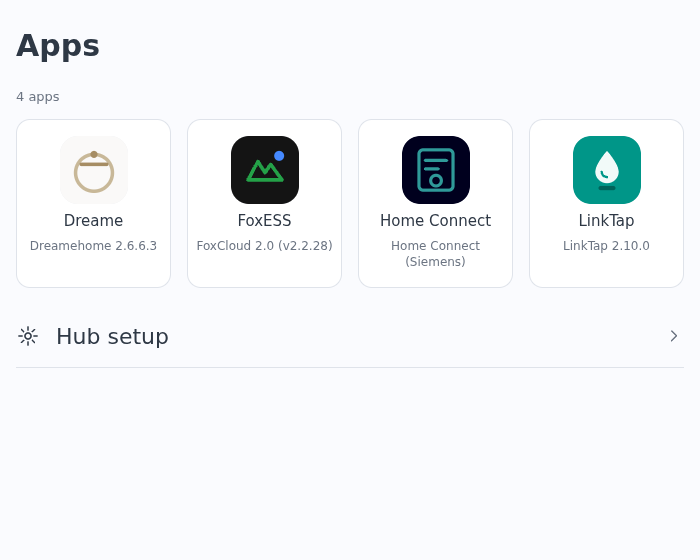
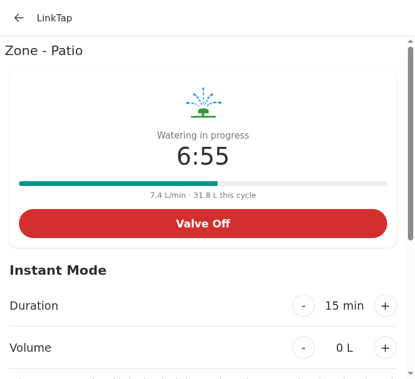
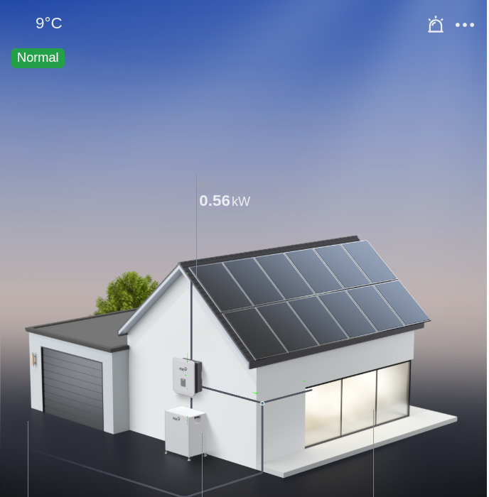
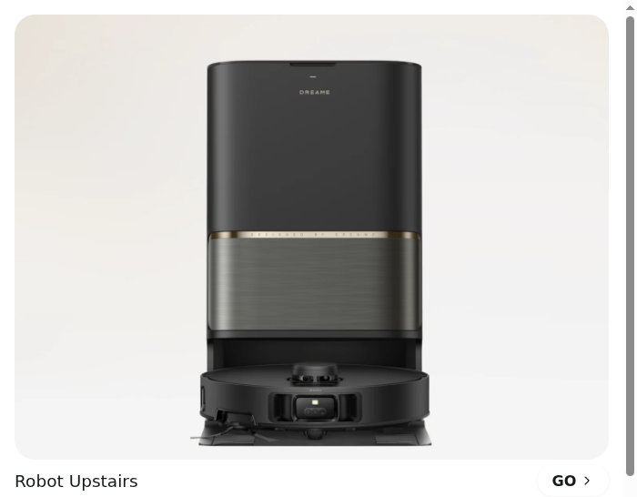
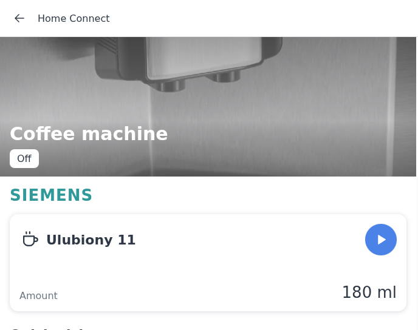
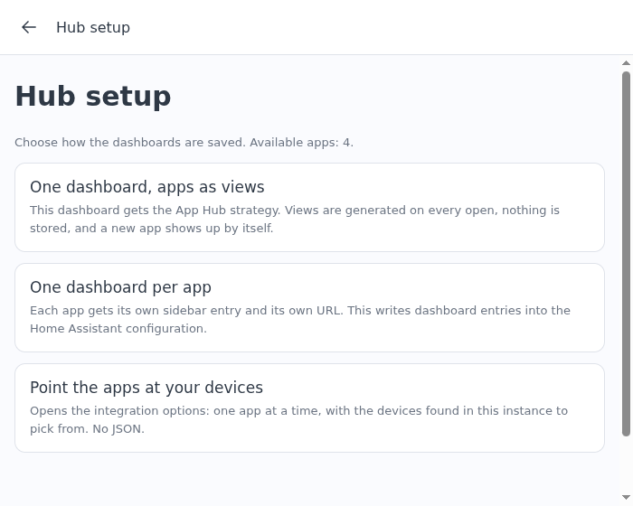

# App Hub

Home Assistant integration that replaces manufacturer mobile apps with dashboards. One launcher,
one app module per manufacturer, and a dashboard strategy that builds the dashboards for you.

> Not affiliated with, endorsed by or sponsored by any manufacturer. See [NOTICE](NOTICE).



Every screenshot on this page is rendered from the demo fixtures in this repository, with the
PoC harness in `poc/`.

## What you get

- **Launcher**: a grid of the installed app modules, like a phone home screen. An app whose
  integration is missing stays visible with the reason, so it does not look like a missing feature.
- **Apps**: full-screen replacements for the producer app's screens, built from the entities an
  existing Home Assistant integration already exposes. Nothing talks to a manufacturer cloud.
- **Setup without JSON**: pick an app, pick the devices the hub found in your instance, done.
- **Two ways to save the dashboards**: one dashboard with an app per view, or one dashboard per app.
- **Sidebar entry**: the launcher as its own panel, full screen, no dashboard around it.
- **Kiosk**: for the card inside a dashboard, optional hiding of the Home Assistant sidebar and
  toolbar, with a back button so there is still a way out. No second plugin needed.

| | |
|---|---|
|  |  |
| LinkTap: zones, instant watering, plans, history | FoxESS: the flow scene, live from the inverter |
|  |  |
| Dreame: robots, rooms, station, consumables | Home Connect: appliance, programmes, care |

## Install

App Hub is an **integration**, not a dashboard plugin. It has no entities and talks to no device: it
serves its own frontend bundle, registers the card and the dashboard strategy for every dashboard,
and adds the sidebar entry. Why an integration and not a plugin or an add-on is in
[DESIGN.md](DESIGN.md).

### HACS

1. HACS, search for **App Hub**, download. Until it is in the default store: three-dot menu,
   **Custom repositories**, `https://github.com/jrx-code/ha-app-hub`, type **Integration**.
2. Restart Home Assistant.
3. Settings, Devices and services, **Add integration**, **App Hub**.

### Manually

Copy `custom_components/app_hub/` into your `config/custom_components/`, restart, then add the
integration. No Lovelace resource to register: the integration loads the card itself.

## Set the apps up



Settings, Devices and services, **App Hub**, **Configure** opens a menu:

- **Hub settings**: the sidebar entry (on, title, icon), the palette (`ha` follows your theme, `app`
  uses the producer colours) and a dry-run switch that logs service calls instead of sending them.
- **Set up an app**: pick the app, then its form. The device picker is filled by a discovery pass
  over your device and entity registries, so in the usual case you tick the devices and submit.
  Every other field on that form is declared by the app itself and keeps its default when left alone.
- **Advanced: edit the JSON**: the same configuration as one object, for the fields a form renders
  badly (an entity map of sixty keys) and for a setup written by hand.

The same forms are reachable from the hub: **Hub setup**, *Point the apps at your devices*.

### Put it on a dashboard

Fastest: Settings, Dashboards, **Add dashboard**, **App Hub** under Community dashboards (Home
Assistant 2026.5 and newer). Nothing to write.

By hand, the launcher:

```yaml
type: custom:app-hub-card
```

By hand, one app full screen:

```yaml
type: custom:app-hub-card
app: linktap
devices:
  - { entity: valve.front_garden }
  - { entity: valve.lawn }
```

### Card options

| Option | Default | Meaning |
|---|---|---|
| `app` | none | enter this app directly; without it the card shows the launcher |
| `devices` | app's manifest default | the devices the app serves |
| `apps` | from the integration | per-app config on a launcher card: `apps: {dreame: {devices: [...]}}`. A card without a block for an app takes that app's configuration from the integration |
| `theme` | `ha` | `ha` follows your Home Assistant theme, `app` uses the producer palette |
| `kiosk` | `false` | shorthand for `hide_sidebar: true` and `hide_header: true` |
| `hide_sidebar` | `false` | hide the Home Assistant sidebar while this card is on screen |
| `hide_header` | `false` | hide the dashboard toolbar |
| `back_button` | `auto` | `auto`, `always` or `never` |
| `back_target` | none | where the back button goes when the card's own stack is empty |
| `height` | `calc(100vh - 56px)` | the card's height |
| `dry_run` | `false` | log service calls instead of sending them |

### Strategy options

```yaml
strategy:
  type: custom:app-hub
  layout: views      # views (default): a view per app. launcher: one view with the launcher
  launcher: true     # keep the launcher as the first view
  kiosk: false
  apps:              # optional; what is not here comes from the integration
    linktap:
      devices:
        - { entity: valve.front_garden }
```

## Apps in this repository

| App | Replaces | Needs |
|---|---|---|
| `homeconnect` | Home Connect (Siemens) | `homeconnect_ws` ([chris-mc1/homeconnect_local_hass](https://github.com/chris-mc1/homeconnect_local_hass)) |
| `dreame` | Dreamehome | `dreame_vacuum` ([Tasshack/dreame-vacuum](https://github.com/Tasshack/dreame-vacuum)), fan screens also `dreame_fan` |
| `foxess` | FoxCloud 2.0 | `foxess_modbus` ([nathanmarlor/foxess_modbus](https://github.com/nathanmarlor/foxess_modbus)) |
| `linktap` | LinkTap | `linktap` (a LinkTap gateway integration) |

An app stays usable when its integration is renamed or forked: working entities satisfy the
requirement, so the launcher only blocks an app whose entities are genuinely absent. What an app
does **not** reproduce is listed in its manifest and shown on its settings screen.

## Adding an app

An app is a directory under `custom_components/app_hub/www/apps/<id>/` with a manifest, a module,
locales, artwork and a fixture. The contract is in [docs/APP-CONTRACT.md](docs/APP-CONTRACT.md); how
the screens are captured from the producer app is in [docs/CAPTURE.md](docs/CAPTURE.md).

```bash
python3 tools/new_app.py <id> --name "<App name>" --integration <ha_integration>
node tools/render_check.mjs <id>        # every screen and sheet, from the fixture, no browser
```

Requesting one: open an issue naming the manufacturer app, its package name, the Home Assistant
integration that already exposes the device, and what the app does that Home Assistant does not.
Without an integration there is no app to build, only an integration to write first.

## Privacy

The hub reads and writes only through integrations you have already installed. It makes no outbound
connection of its own, holds no credentials, and has no cloud component.

The repository is written to carry no identifying data: the demo fixtures are scrubbed captures,
with rooms, zones, device ids and serials replaced, and `tools/anonymise_fixtures.py --check` scans
every tracked file for what must not be there. The developer tools read the address of their test
instance from `tools/test_instance.local.json`, which is not in the repository; see
`tools/test_instance.example.json`. Security policy: [SECURITY.md](SECURITY.md).

## Development

```bash
python3 -m http.server -d . 8000   # then open http://localhost:8000/poc/
```

The PoC harness feeds the card a stand-in `hass` object built from the chosen app's `fixture.json`,
with buttons for the app, the card width (360, 700, 1000) and the options; `?lang=en` renders the
English interface. Service calls are logged instead of sent.

### Checks

```bash
pip install -r requirements_test.txt
pytest -q                               # config flow, options flow, manifests, discovery, strings
ruff check custom_components tests tools
node tools/render_check.mjs dreame      # every screen and sheet of one app, from its fixture
python3 tools/anonymise_fixtures.py     # nothing identifying in any tracked file
python3 tools/gen_strings.py            # the per-app field labels match the manifests
python3 tools/notice.py                 # the trademark table matches the manifests
```

`requirements_test.txt` pins `home-assistant-frontend` next to the test harness: this integration
depends on the `frontend` component, which refuses to set up without the compiled frontend package.

## Notes that cost time to learn

- Home Assistant serves `/local` with `Cache-Control: public, max-age=2678400`. The card therefore
  propagates the `?v=` of its own resource URL to every module, manifest, locale and image it loads,
  including the core; a static `import` cannot carry that query, which is why the core is imported
  dynamically.
- Breakpoints are CSS container queries on the card, not viewport media queries: a card can be narrow
  on a wide screen.
- The hub bar owns the back control when it is shown, and an app reads `ctx.chrome.back` so it does
  not draw a second one.

## Licence

MIT for the code. Trademarks and producer imagery are not covered by it, see [NOTICE](NOTICE).
